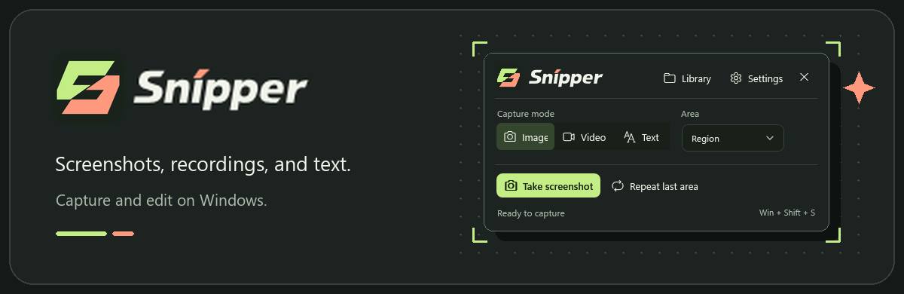
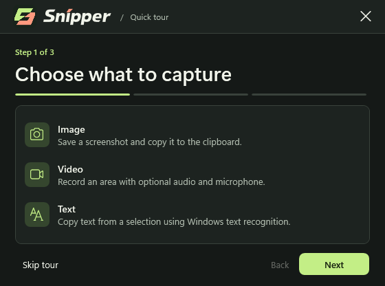

  

  <a href="https://github.com/wochub/snipper/releases/download/v1.1.0/Snipper-Setup-1.1.0-x64.exe"><strong>↓ Download for Windows</strong></a>
  &nbsp;·&nbsp;
  <a href="https://github.com/wochub/snipper/releases/tag/v1.1.0">Release notes</a>
  &nbsp;·&nbsp;
  <a href="https://www.virustotal.com/gui/file/93ece9162abc0da0f9e9d62de2548cd84ed04904c53f5f35526e27f28040b526/detection">VirusTotal report</a>

## What can you snip?

| Image | Video | Text |
| --- | --- | --- |
| Capture a region, window, or monitor. Mark it up and copy it. | Record your screen with optional audio, then trim the clip. | Select text on your screen and copy it with Windows text recognition. |

## Get started

Run the installer on Windows 11 x64. Setup downloads a pinned FFmpeg package and verifies its SHA-256, so keep your internet connection on during installation. Open Snipper from the Start menu. You can skip the three-step tour or replay it any time from Settings.

  

## Installer details

The installer is unsigned. On November 21, 2026, VirusTotal reported **1 detection out of 67 vendors** for this installer. Deep Instinct flagged the file. [See the per-vendor results](https://www.virustotal.com/gui/file/93ece9162abc0da0f9e9d62de2548cd84ed04904c53f5f35526e27f28040b526/detection).

SHA-256

`93ece9162abc0da0f9e9d62de2548cd84ed04904c53f5f35526e27f28040b526`
